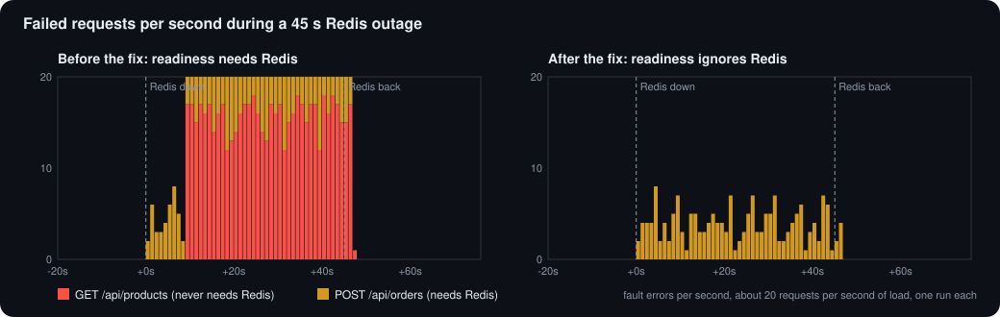

# Postmortem: a Redis outage took product browsing down too

**Date:** 2026-11-18. **Where:** a local kind cluster (3 nodes, GitOps install), found by a chaos experiment, not in production.
**Status:** fixed and re-measured. Two follow-ups are still open (see the action items).
**Experiment:** [`chaos-experiments.md`](../chaos-experiments.md), experiment 3b. Raw numbers: `docs/chaos-results/`.

## Summary

With Redis down for 45 seconds under steady load, **every API pod left the Service and `GET /api/products` returned 503**,
although that endpoint never touches Redis. The cause was the readiness probe, which required a working Redis connection.
I predicted this from reading the code, then my first experiment seemed to prove me wrong (Redis came back in 3 seconds,
faster than the probe noticed), and a longer outage showed the prediction was right.

## Impact

Measured from the client side, through Traefik, about 20 requests a second (80% `GET /api/products`, 20% `POST /api/orders`),
inside the 45 s outage window plus the recovery:

| | Before the fix | After the fix |
|---|---|---|
| Product requests failed | **602** | **0** |
| Order requests failed (503) | 198 | 182 |
| Error ratio in the window | 75.3% | 19.5% |
| Burn rate against the 1% error budget | 75.3x | 19.5x |
| Longest stretch with no successful product response | 38.1 s | 0.3 s |
| API pods Ready during the outage | 0 of 2 | 2 of 2 |

(Drawn from the raw request logs by `scripts/chaos-chart.py`.)

Orders still fail while Redis is down. The fix was never meant to change that. It stops the outage from also taking browsing down.

## Timeline (before the fix, seconds after Redis was scaled to 0)

| t | What happened |
|---|---|
| +0.0 | Redis scaled to 0 (Argo CD's self-heal switched off for the run) |
| +0.2 | First `POST /api/orders` returns 503 `order store unavailable` (the app's own response) |
| +7.1 | First API pod fails its second readiness probe and leaves the Service |
| +8.2 | Both API pods NotReady |
| +9.4 | `GET /api/products` returns 503 from Traefik, which has no endpoints left |
| +45.0 | Redis scaled back to 1 |
| +46.9 | Redis Ready; product requests succeed again |
| +53.0 | Both API pods Ready |

## Root cause

`/ready` returned 503 whenever the Redis client was not ready. Kubernetes removes an unready pod from the Service, so after two
failed probes (2 x 5 s) no pod was left to serve **any** route. Only `/api/orders` needs Redis, and it already answered 503 on its
own when Redis was down. Coupling readiness to Redis added nothing for orders and cost the routes that did not need it.

Liveness was designed correctly: it never touched Redis, so healthy pods were not restarted. The mistake was in readiness only.

## Why my first experiment did not show it

Experiment 3 deleted the Redis pod. It came back in about 3 seconds, shorter than the two failed probes the API needs to leave the
Service, so nothing happened: 0 failed product requests and 4 failed orders over about a second. My hypothesis said "20 to 60 s of
failures" and that run refuted it, for a timing reason, not a design one. Experiment 3b exists because of that. A first run of 3b was
also invalid: Argo CD's self-heal restored the StatefulSet's replica within seconds, so Redis was down for about 7 s. The data is kept
in `docs/chaos-results/2026-11-18/redisdown-run1-selfheal-reverted-it/`. The valid run switches self-heal off for its duration.

## What went well

- The hypothesis was written and committed before the run, so the miss on experiment 3 is on record and not rewritten.
- Liveness did not depend on Redis, so no pod was restarted during the outage.
- Recovery was fast once Redis returned: all pods Ready 6.1 s later.
- The SLO alert did not page, as predicted. A 47-second outage is real but short for a multiwindow burn-rate alert (see below).

## What went badly

- **Nothing paged.** The fast-burn alert needs the 1 h and 5 m error ratios above 14.4%. The worst 5-minute ratio seen was 1.37%.
  The alert is tuned for sustained burns, so a total outage of a minute is invisible to paging. That is a property of this design,
  not a bug, but it means short outages are only found by looking.
- **The app's metrics under-count what users get.** While the pods were NotReady, Traefik answered 503s that never reached the app,
  so the app's own request metrics never saw them. Clients received 800 fault errors in that run; the app counted 143 server errors
  in the 15 minutes around it, and that figure also includes the simulated payment failures and the earlier order failures. The SLO
  is measured at the wrong place for this failure: it cannot see errors generated in front of the pods.
- **A manual `kubectl scale` is undone within seconds** under Argo CD self-heal (the same for deleting a NetworkPolicy: restored in
  about 1 s). Good for drift, but anyone handling a real incident has to switch self-heal off first, and that needs to be written down.

## Action items

| | Item | Status |
|---|---|---|
| 1 | Take Redis out of readiness; report it in the `/ready` body and in a new `shop_redis_up` metric | **Done and re-measured** |
| 2 | Alert on `shop_redis_up == 0` for a minute, so a Redis outage is noticed even when it is short | Open |
| 3 | Measure the availability SLI at the ingress (Traefik's metrics), so errors generated in front of the pods count | Open |
| 4 | Redis with a replica and failover, so ordering survives a Redis loss | Open, larger change |

## What I would say in an interview

I predicted a failure from reading code, tested it, and my first test said I was wrong. Instead of dropping the idea I asked why the
test could not have shown it, found that the outage was shorter than the probe window, and ran a longer one that confirmed it.
Then I fixed the cause and ran the same experiment again to see the number change.
